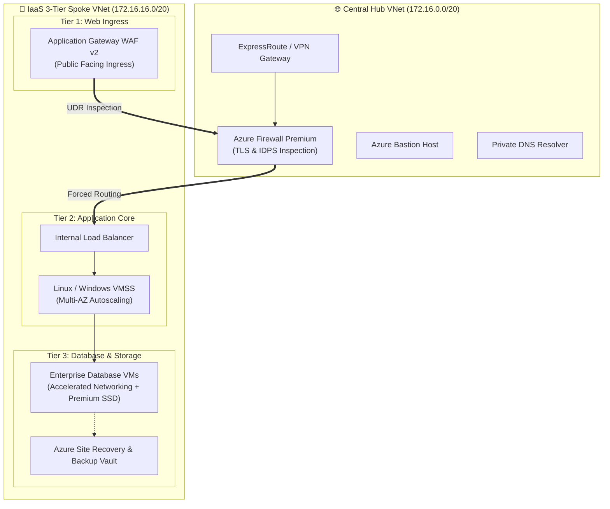

<div align="center">

  

  <p align="center">
    
    
    
    
    
  </p>

</div>

---

## 🏛️ Architecture Overview

This repository delivers a **production-hardened Infrastructure-as-a-Service (IaaS) Enterprise Landing Zone** designed according to Microsoft Cloud Adoption Framework (CAF) best practices.

It isolates enterprise workloads into a secure **3-Tier compute model** connected to a central **Hub Virtual Network** with centralized egress inspection, private management, and automated disaster recovery.



---

## ⚡ Key Features

| Pillar | Capability & Production Hardening |
| :--- | :--- |
| **🌐 Central Hub Network** | Hub VNet with dedicated `AzureFirewallSubnet`, `GatewaySubnet`, `AzureBastionSubnet`, and Route Tables. |
| **🛡️ Zero-Trust Security** | Azure Firewall Premium with IDPS and TLS inspection enforcing `0.0.0.0/0` outbound inspection via UDRs. |
| **💻 Scalable IaaS Compute** | Virtual Machine Scale Sets (VMSS) running across Availability Zones (1, 2, 3) with metric-based autoscale. |
| **🚦 Traffic Balancing** | Application Gateway WAF v2 for public traffic; Internal Standard Load Balancers for east-west traffic. |
| **💾 Storage & Backups** | Premium SSD Managed Disks with Customer-Managed Keys (CMK) and Recovery Services Vault automated backups. |
| **🔄 DevSecOps Automation** | Complete CI/CD pipeline with TFLint, Checkov SAST, TruffleHog, and Infracost cost estimation. |

---

## 📁 Repository Structure

```text
Enterprise-Azure-IaaS-Landing-Zone/
├── .github/workflows/
│   └── devsecops-ci-cd.yml       # Multi-stage CI/CD: Lint, SAST, Plan, Deploy
├── terraform/
│   ├── modules/
│   │   ├── hub_network/          # Hub VNet, Azure Firewall, Bastion, UDR
│   │   ├── iaas_compute_vmss/    # App Gateway WAF, Internal LB, VMSS
│   │   └── iaas_storage_backup/  # Recovery Services Vault, Backup Policies
│   └── environments/
│       └── prod/
│           ├── main.tf           # Root Orchestrator
│           ├── variables.tf
│           ├── terraform.tfvars
│           └── versions.tf
└── README.md
```

---

## 🚀 Quick Start & Deployment

### Prerequisites
* Terraform `>= 1.5.0`
* Azure CLI `>= 2.50.0`
* Active Azure Subscription with Owner / Contributor permissions

### Local Execution

```bash
cd terraform/environments/prod

# Initialize Terraform modules and providers
terraform init

# Validate configuration syntax
terraform validate

# Review execution plan and resource changes
terraform plan

# Apply infrastructure deployment
terraform apply -auto-approve
```

---

## 👤 Author
**Raghvendra Singh**  
Lead DevSecOps Architect & Enterprise Cloud Strategist  
GitHub: [@raghvendrasingh-devops](https://github.com/raghvendrasingh-devops)  
LinkedIn: [raghvendra-singh-devops](https://linkedin.com/in/raghvendra-singh-devops)
